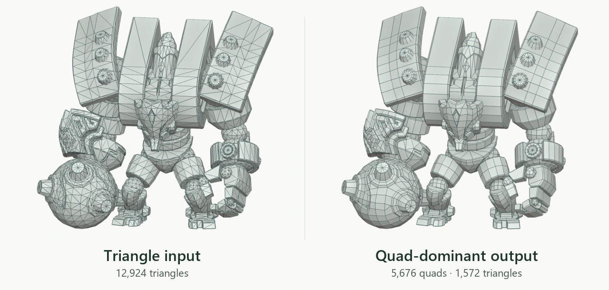
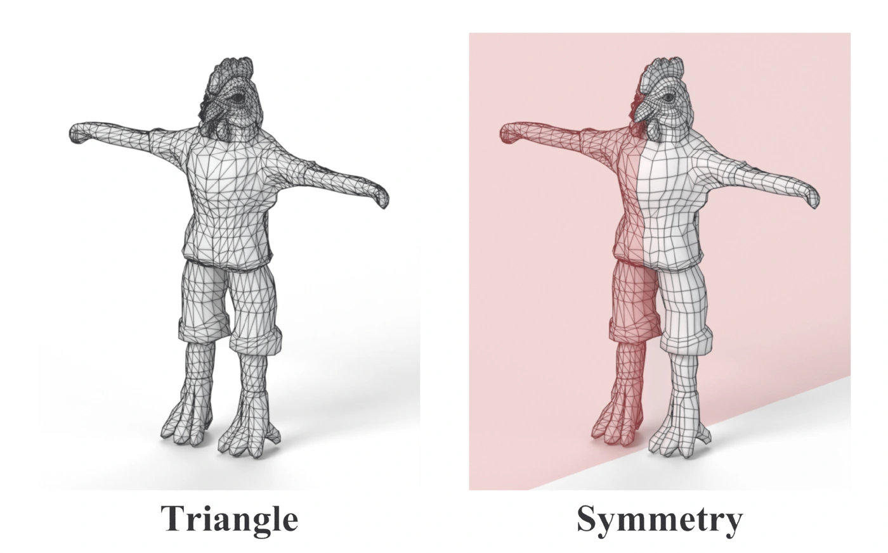

# Tri-to-Quad Operator

Tri2Quad converts triangle meshes into quad-dominant meshes. We used it to curate the training data for [QuadLink](https://github.com/Graphic-Kiliani/QuadLink).

The operator filters adjacent triangle pairs by geometry and selects disjoint merges using maximum-weight matching. Unmatched triangles stay in the output. See the method and implementation details in the [QuadLink paper](https://arxiv.org/abs/2605.16813).



## Install

On Linux, use Python 3.9 or newer, Python development headers, and a C++17 compiler.

```sh
python -m pip install .
```

For FBX, install the Assimp development library (`libassimp-dev` on Ubuntu) and run `python -m pip install '.[fbx]'`.

## Use

Pass a triangulated mesh (`.obj`, `.glb`, `.gltf`, or `.fbx`).

### Command line

```sh
quad-convert --input mesh.obj --output mesh_quad.obj \
  --method global --angle_threshold 150 --feature_dihedral 45 \
  --planarity_eps 0.02 --verbose
```

| Control | CLI | Python |
| --- | --- | --- |
| Quad angles before and after matching | `--pre_angle_min`, `--pre_angle_max`, `--angle_threshold` | `pre_angle_min_deg`, `pre_angle_max_deg`, `angle_threshold_deg` |
| Protect sharp edges by dihedral angle | `--feature_dihedral` | `feature_dihedral_thresh_deg` |
| Screen concave and self-crossing candidates by default | `--disable_concavity_prefilter` turns it off | `enable_concavity_prefilter=False` turns it off |
| Limit non-planarity relative to mean edge length (off at 0) | `--planarity_eps` | `planarity_eps` |
| Add edge-alignment scoring | `--enable_edge_align --alpha_align 0.2` | `enable_edge_align=True`, `alpha_align=0.2` |

Normal checks run automatically. The converter rejects merges between triangles with opposing normals and orients each new quad to match its source triangles. Start with consistently oriented input faces.

Use `--method greedy` for local matching or `--method global` for maximum-weight matching. Run `quad-convert --help` for all options.

For FBX with UV seams, use `--split_by_uv`. The three controls below can be combined.

```sh
quad-convert --input mesh.fbx --output mesh_quad.obj \
  --split_by_uv --enable_symmetry_protect --repair_spirals --detect_spirals
```

### Python

Pass `(N, 3)` vertex coordinates and `(M, 3)` zero-based triangle indices.

```python
from quad_converter import tri_to_quad

result = tri_to_quad(
    vertices, faces, method="global",
    pre_angle_min_deg=30, pre_angle_max_deg=140,
    feature_dihedral_thresh_deg=45, planarity_eps=0.02,
)
vertices = result["new_vertices"]
quads, triangles = result["quads"], result["tris"]
print(result["merge_stats"])
```

`convert_tri_to_quad` is an alias for `tri_to_quad`. Run `python test.py` for a two-triangle example.

Compared with the previous release, this version adds three optional controls for producing production-ready quad-dominant meshes.

## Symmetry

`--enable_symmetry_protect` detects a reflection plane and keeps edges on it.



## UV seams

`--split_by_uv` converts FBX UV islands separately, keeping their seams and UV coordinates.


## Spiral repair

`--repair_spirals` changes local triangle pairings to reduce winding without losing quads. Red marks the detected winding edges. On this synthetic tube, the count drops from 59 to 0 with 191 quads in both meshes.


[License](LICENSE) · [LEMON license](third_party/LEMON-LICENSE)
