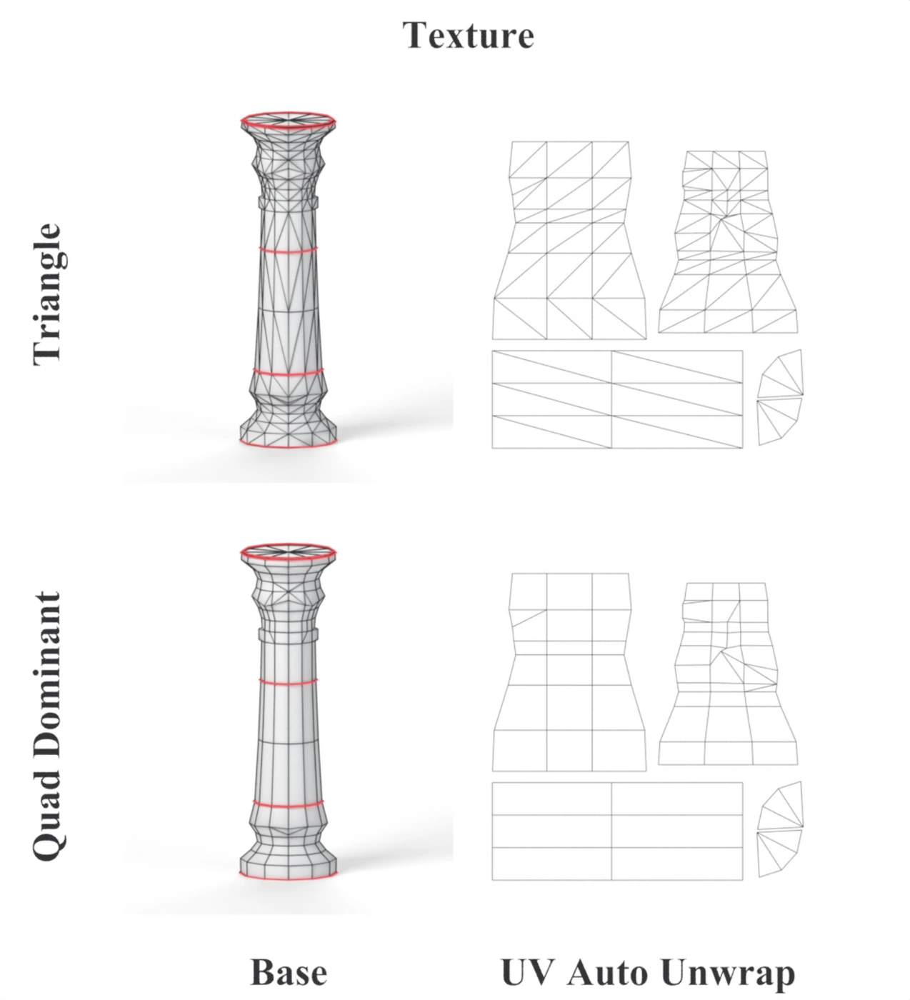
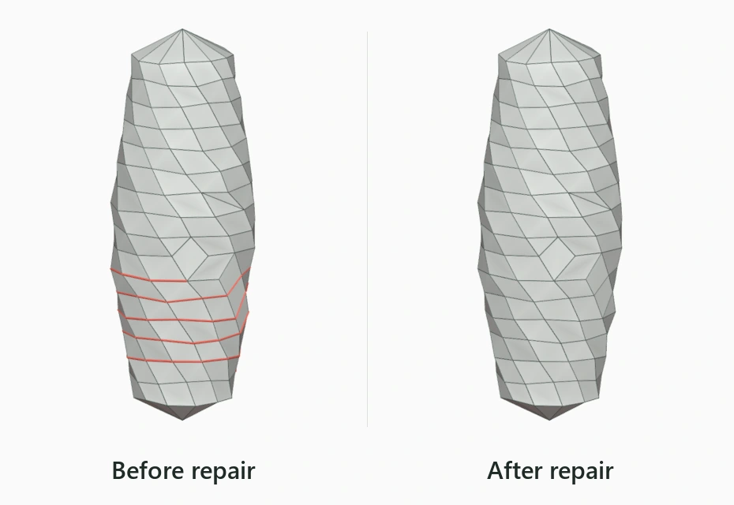

# Tri-to-Quad Operator

Converts triangle meshes to quad-dominant meshes for [QuadLink](https://github.com/Graphic-Kiliani/QuadLink). Geometric filters screen candidate pairs before global matching.

## Install

On Linux, use Python 3.9 or newer, Python development headers, and a C++17 compiler.

```sh
python -m pip install .
```

For FBX, install the Assimp development library (`libassimp-dev` on Ubuntu) and run `python -m pip install '.[fbx]'`.

## Use

```sh
quad-convert --input mesh.obj --output mesh_quad.obj

quad-convert --input mesh.fbx --output mesh_quad.obj \
  --split_by_uv --enable_symmetry_protect --repair_spirals --detect_spirals
```

The input must be triangulated. From Python, call `quad_converter.tri_to_quad(vertices, faces, method="global")`. Run `python test.py` for a small example.

## Symmetry

`--enable_symmetry_protect` detects a reflection plane and keeps edges on it.


## UV seams

`--split_by_uv` converts FBX UV islands separately, keeping their seams and UV coordinates.



## Spiral repair

`--repair_spirals` changes local triangle pairings to reduce winding without losing quads. Red marks the detected winding edges. On this synthetic tube, the count drops from 59 to 0 with 191 quads in both meshes.



[Paper](https://arxiv.org/abs/2605.16813) · [License](LICENSE) · [LEMON license](third_party/LEMON-LICENSE)
